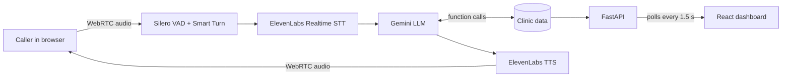

# Meridian Clinic: Voice AI Appointment Assistant

> Call the clinic, talk to **Asha**, and get an appointment booked or cancelled in under a minute. No forms, no hold music.

Asha is a real-time voice receptionist built with **Pipecat**, **Google Gemini** and **ElevenLabs**. A reception dashboard shows every booking, cancellation and open slot live while the call is still going.


## What it does

| Caller says | Asha does |
| --- | --- |
| "I'd like to see a cardiologist tomorrow" | Checks availability and offers up to three real slots |
| "Book the 2 PM one" | Asks for the mobile number, reads it back digit by digit, books only after a clear "yes" |
| "Cancel my appointment" | Verifies the number the same way, cancels, and frees the slot |

Asha speaks in short, natural sentences, asks one question at a time, never invents doctors or slots, and gives no medical advice. For emergencies she tells the caller to contact emergency services.

## Architecture



1. **Transport:** SmallWebRTC carries the caller's microphone to the bot and Asha's voice back.
2. **Turn detection:** Silero VAD finds speech, and Smart Turn decides when the caller has actually finished a thought, so Asha does not cut in on pauses.
3. **Speech to text:** ElevenLabs Realtime STT transcribes the caller as they speak.
4. **Reasoning:** Gemini understands the request and calls tools to read or change real data.
5. **Text to speech:** ElevenLabs TTS turns the reply into a natural voice.
6. **Dashboard:** a FastAPI service exposes the clinic data, and a React app polls it every 1.5 seconds.

## Tools the agent can call

| Tool | Purpose |
| --- | --- |
| `check_doctor_availability` | Returns open slots by doctor or speciality and date |
| `book_appointment` | Books a slot (requires `phone_confirmed = true`) |
| `cancel_appointment` | Cancels an appointment (requires `phone_confirmed = true`) |

The assistant may only offer what these tools return. That is how hallucinated slots are avoided.

## Design decisions

- **Identity by spoken phone number.** There is no login on a phone call, so the number is the identifier. It is read back in groups of digits, and no booking or cancellation happens until the caller says yes. This protects against speech-to-text mistakes.
- **Confirmation flag in the tools.** `phone_confirmed` is a required argument, so the model cannot book or cancel without having gone through the read-back step.
- **Voice-first prompt.** Dates and times are written the way people say them ("Monday, 30 November", "10 30 in the morning"), and lists, markdown and emojis are banned, because the output is spoken.
- **Live dashboard.** Bookings appear while the call is in progress, which makes the agent's actions visible and easy to verify. Cancelled rows stay visible and are marked Cancelled.
- **Demo "Try call" button.** A real clinic would receive phone calls. Here the browser plays the patient's phone and runs the same voice pipeline. Pipecat also supports telephony transports such as Twilio and Telnyx, so a real number can be added later.

## Project structure

```
pipecat-quickstart/
  server/
    bot.py        Voice pipeline, system prompt and tool registration
    clinic.py     Doctors, slots, booking and cancellation logic
    api.py        FastAPI service used by the dashboard
    .env.example  Template for required keys
  frontend/
    src/          React dashboard and phone-style call screen
```

## Getting started

### Requirements

- Python 3.12 and [uv](https://docs.astral.sh/uv/)
- Node.js 18 or newer
- A Google AI Studio API key (Gemini)
- An ElevenLabs API key

### Setup

```bash
git clone https://github.com/latashasingh/meridian-voice-clinic.git
cd meridian-voice-clinic

cd server
copy .env.example .env      # on macOS/Linux: cp .env.example .env
# open .env and add your own keys

cd ../frontend
npm install
```

### Run (three terminals)

```bash
# Terminal 1: voice bot
cd server
uv run bot.py

# Terminal 2: dashboard API
cd server
uv run uvicorn api:app --port 8000

# Terminal 3: dashboard
cd frontend
npm run dev
```

Open **http://localhost:5173**, press **Try call**, allow the microphone and say hello to Asha.

On Windows PowerShell, if `npm` is blocked by the execution policy, use `npm.cmd` instead.

### Configuration

| Variable | Purpose |
| --- | --- |
| `GOOGLE_API_KEY` | Gemini API key |
| `GEMINI_MODEL` | Gemini model name, for example `gemini-3.1-flash-lite` |
| `ELEVENLABS_API_KEY` | ElevenLabs API key |
| `ELEVENLABS_VOICE_ID` | Voice used by Asha |

## Demo script

1. Open the dashboard. It shows "Nothing booked yet" and the doctors' open slots.
2. Press **Try call** and say: *"Hi, I'd like to book a cardiologist appointment."*
3. Choose a slot, say your 10-digit number, and confirm the read-back with "yes".
4. Watch the booking appear on the dashboard and the slot disappear from the doctor's list.
5. Call again: *"I want to cancel my appointment."* Confirm the number. The row turns Cancelled and the slot returns.

## Troubleshooting

| Symptom | Likely cause and fix |
| --- | --- |
| Asha is silent, log shows `503 UNAVAILABLE` | The Gemini model is overloaded. Set another model in `GEMINI_MODEL` and restart the bot |
| Log shows `completed with no audio` | The ElevenLabs voice is not allowed on your plan. The free plan cannot use library voices through the API, so use a premade voice |
| Your words appear but there is no reply | Check the bot terminal for `ERROR` lines (Gemini or ElevenLabs) |
| `only one usage of each socket address` | An old bot is still running on port 7860. Stop it and start again |
| Dashboard says "Connection problem" | The bot or API is not running. Start both |

## Limitations and next steps

- Doctors and appointments are sample demo data. No real call, SMS or notification is sent.
- Free-tier Gemini and ElevenLabs plans can be rate limited or busy, which may add delay.
- Next: automatic fallback between Gemini models, SMS or WhatsApp confirmation, a real phone number through Twilio or Telnyx, and Hindi support.

## Tech stack

Python, Pipecat, Google Gemini, ElevenLabs (Realtime STT and TTS), Silero VAD, Smart Turn, SmallWebRTC, FastAPI, React, Vite.
